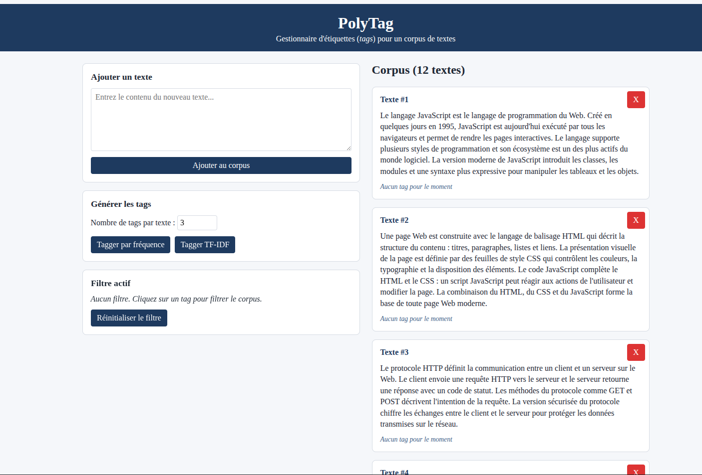
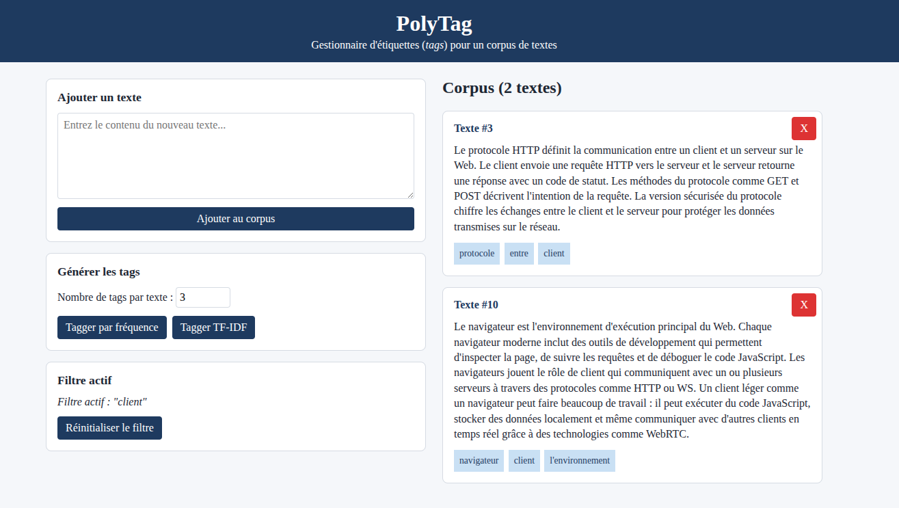

# TP2 - PolyTag

Le but de ce travail est de vous introduire au langage de programmation JavaScript (variables, fonctions, objets, traitement des tableaux, classes, modules ESM, etc.), la configuration d'un outil de développement ainsi qu'introduire des notions de vérification automatisée à travers des tests unitaires. Vous allez vous familiariser avec la syntaxe moderne (ES2015+) et vous utiliserez quelques notions de base de la manipulation du DOM d'une page web.

## Installation des librairies nécessaires

Pour installer les dépendances nécessaires, lancez la commande `npm ci` dans la racine du projet. Ceci installera toutes les librairies définies dans le fichier `package.json` avec les versions exactes définies dans `package-lock.json`.

## Exécution des tests

Consultez le fichier [TESTS.MD](./TESTS.MD) pour plus d'informations sur les tests fournis.

## Analyse statique du code

Vous utiliserez l'outil d'analyse statique (_linter_) `ESLint`. Cet outil permet de vérifier que votre code respecte un certain nombre de règles définies dans le fichier de [configuration](./eslint.config.mjs). Par exemple : vous ne pouvez pas utiliser le mot clé `var` (règle `no-var`), vous devez utiliser `===` et non `==` (règle `eqeqeq`), etc. Vous pouvez lancer cet outil à l'aide de la commande `npm run lint` dans votre terminal.

## Déploiement local

Vous pouvez faire un déploiement local de votre site avec l'outil `http-server`. Si vous lancez la commande `npm start`, un serveur HTTP statique sera déployé sur votre machine et votre site sera accessible sur l'adresse `localhost:3000` ou `<votre-adresse-IP>:3000`. La sortie dans le terminal vous donnera l'adresse exacte d'accès.

À la fin du travail, vous aurez configuré un outil différent qui permettra d'avoir le même comportement avec quelques fonctionnalités supplémentaires.

# Description du travail à compléter

Le but de ce travail est de construire un outil de création d'étiquettes (_tags_) pour du contenu textuel.

Un problème classique dans le traitement de données est de pouvoir catégoriser du contenu de manière automatique. Vous allez mettre en place deux stratégies : une de base et une plus sophistiquée.

Le site web vous permettra de charger un jeu de données (_corpus_) de base et de générer des tags pour chaque document (texte) du corpus.

Voici le visuel de la page web avant toute interaction : 

<div style="display:flex; justify-content:center; width:100%; margin:20px">
    
</div>

Chaque document du corpus est affiché dans une carte avec un bouton de suppression et une liste de tags générée en fonction de la stratégie choisie. Cliquer sur un tag applique un filtre pour n'afficher que les éléments du corpus ayant ce tag. Vous pouvez également ajouter un document personnalisé au corpus en remplissant le champ de texte et en cliquant sur le bouton "Ajouter au corpus".

Voici un exemple d'un tri sur le tag `client` :
<div style="display:flex; justify-content:center; width:100%; margin:20px">
    
</div>

Le code HTML et CSS de la page est déjà fourni ainsi qu'une grande partie d'interaction avec le DOM dans le fichier [ui.js](./src/assets/js/ui/ui.js). Votre tâche sera majoritairement faite dans les autres fichiers `.JS` : votre travail pourra être validée par des tests sans utiliser un navigateur.

Vous devez répondre à certaines questions dans le fichier [RAPPORT.MD](./RAPPORT.MD). Dans certains cas, vous devez fournir des captures d'écran et dans d'autres, vous devez simplement répondre textuellement. Vous devez compléter le fichier `RAPPORT.MD` et le remettre avec votre travail.

## Partie 0 : Fonctions JS et outils de débogage

Pour commencer, vous devez implémenter la fonction `createTagFilter` dans [utils.js](./src/assets/js/library/utils.js). Cette fonction prend en paramètre une chaîne de caractères et retourne une **fonction** qui sera utilisée par la fonction `filter` de l'objet `Library` pour filtrer les éléments du corpus par la présence ou non d'un tag. Consultez la fonction `#applyTagFilter` dans `ui.js` pour voir comment cette fonction est utilisée.

Vous pouvez tester la fonction à l'aide des tests unitaires fournis dans [utils.test.js](./tests/utils.test.js). Pour lancer seulement ces tests, utilisez la commande `npm run test:unit` dans votre terminal.

### Débogage avec l'objet Console

Pour tester cette fonctionnalité à l'aide de l'interface web, vous pouvez modifier le 1er élément du corpus à la fin du constructeur de la classe `UI`. Ajoutez le code suivant pour vérifier le contenu de l'objet avant et après la modification :
```js
console.log(this.#library.texts);
this.#library.texts[0].tags = ["tag1", "tag2"];
this.#library.texts[1].tags = ["tag2"];
console.log(this.#library.texts);
```

Vous aurez 1 document avec 2 tags et 1 document avec un seul tag commun aux deux (`tag2`).

Vous pouvez voir le contenu d'un objet JavaScript à travers la console du navigateur et la fonction `console.log()`. Pour ouvrir la console, utilisez le raccourci clavier <kbd>Ctrl + Shift + I</kbd> ou <kbd>F12</kbd> et cliquez sur l'onglet "Console" si ce n'est pas l'onglet par défaut.

#### Questions pour le rapport : débogage avec console.log

1. Ouvrez votre console et observez les messages affichés. Quelle est la taille du tableau `texts` avant et après la modification ?

Ouvrez les détails du premier message (avant modification) avec le bouton ▶ à gauche et observez le contenu du tableau `tags` du 1er élément du tableau.

2. Quel est le contenu du tableau `tags` et que peut expliquer ce comportement ? Consultez la documentation de [console.log](https://developer.mozilla.org/en-US/docs/Web/API/console/log).

### Débogage avec le débogueur

Pour avoir accès à un outil plus puissant de votre navigateur, le débogueur, vous pouvez utilisez la commande `debugger;` dans votre code pour ajouter un point d'arrêt (_breakpoint_). Lorsque le navigateur rencontre cette commande, il arrête l'exécution du code et vous permet d'inspecter les variables et l'état du programme à ce moment précis. Vous pouvez ensuite reprendre l'exécution pas à pas pour comprendre le flux de votre programme. Notez que cette commande est exécutée uniquement si les outils de développement du navigateur sont ouverts.

Ajoutez la ligne `debugger;` au début de la fonction `#applyTagFilter` pour inspecter le contenu de l'objet `Library` et vérifier que la fonction `createTagFilter` fonctionne correctement. Vous pouvez ensuite cliquer sur un tag pour déclencher cette fonction et inspecter les variables dans le débogueur.

Une fois dans l'onglet `Sources` des outils de développement, vous pouvez ajouter vos propres points d'arrêt en cliquant sur le numéro de ligne dans le fichier source.

#### Questions pour le rapport : débogage avec le débogueur

Cliquez sur un tag pour déclencher la fonction `#applyTagFilter`.

1. Quelle est la valeur de l'objet `filteredLibrary` ?

Utilisez le débogueur pour avancer dans les appels de fonctions (raccourcis <kbd>F10</kbd> et <kbd>F11</kbd>) jusqu'à après l'exécution de la fonction `createTagFilter`. Prenez une capture d'écran de l'état du débogueur pour montrer les valeurs de l'objet `filteredLibrary` et `this` ainsi que la pile d'appels (_Call Stack_). Ajoutez cette capture d'écran à votre rapport. 

2. Quelle est la valeur du dernier élément de la pile d'appels et que représente-t-il ?

## Partie 1 : Implémentation de l'outil

La partie principale est le fonctionnement de l'outil de création de tags. Vous pouvez commencer par l'interface graphique ou par l'étape 2 et utiliser les tests unitaires pour valider votre code.

### Étape 1 : Complétion de l'interface graphique

Vous devez compléter le code manquant dans la classe `UI` dans le fichier [ui.js](./src/assets/js/ui/ui.js). Vous devez compléter les méthodes suivantes :
1. `bindListeners` pour la gestion des clics sur les boutons de l'interface. Rappel : une classe en JS est une fonction constructeur comme une autre fonction et peut donc être passée en paramètre à une autre fonction.
2. `#createTextCard` pour la génération de la carte d'un document du corpus. Vous pouvez consulter le fichier `index.html` pour voir la structure HTML finale à obtenir.

### Étape 2 : Implémentation de la classe Library

Vous devez compléter la classe `Library` dans le fichier [library.js](./src/assets/js/library/library.js). Cette classe représente un corpus de documents textuels et permet de filtrer les documents par tag. Vous devez compléter les méthodes suivantes :

1. Le constructeur qui est fonctionnel, mais trop verbeux. Vous devez le réécrire en remplaçant la boucle `forEach` par une autre méthode d'itération d'un tableau. Défi supplémentaire : remplacez `if/else` par un seul opérateur booléen dans votre transformation.
2. Les méthodes `addText`, `removeText` et `getText` qui permettent de manipuler le contenu de l'objet `texts` de la classe. Tout comme le constructeur, vous devez utiliser les méthodes d'itération des tableaux et non des boucles `for(;;)` ou `while()` classiques.

Vous pouvez tester votre implémentation à travers la page web, même si l'étape 1 n'a pas été complétée : vous devriez pouvoir ajouter et supprimer des documents dans le corpus.

### Étape 3 : Implémentation de la classe Tagger

Vous pouvez commencer par implémenter l'approche "naïve" de classification dans la classe `Tagger` dans le fichier [tagger.js](./src/assets/js/tagger/tagger.js). Cette approche vise à simplement compter la fréquence de chaque mot dans le document et retourner les mots les plus fréquents comme tags. Le _score_ d'un mot est calculé comme le nombre d'occurrences divisé par le nombre total de mots dans le document ou le _Term Frequency_ (TF).

La génération des tags se fait à travers un pipeline linéaire : extraire les mots -> calculer leur fréquence -> calculer leur score -> trier par score -> retourner les `N` mots les plus fréquents. La manière d'extraire les mots d'un document vous est déjà fournie dans la méthode `tokenize`.

Vous devez mettre en place des accesseurs aux attributs privés de la classe et compléter les méthodes suivantes : 
1. `computeFrequency` : cette fonction contient une erreur dans sa logique. Vous devez la corriger et réécrire la fonction sans utiliser une boucle `for(;;)` ou `while()` classique en utilisant les méthodes d'itération des tableaux. Un des tests fournis échouera initialement : n'oubliez pas de modifier le titre du test après avoir apporté la correction nécessaire.
2. `getTags` : cette fonction permet d'extraire les tags d'un document en appliquant la séquence d'opérations décrite plus haut. Vous devez compléter la fonction sans utiliser de boucle `for(;;)` ou `while()` classique en utilisant que les méthodes d'itération des tableaux.

Vous pouvez tester votre implémentation à travers les tests unitaires ou la page web si l'étape 1 a été complétée. Vous devriez pouvoir générer des tags pour chaque document du corpus.

### Étape 4: Implémentation de la classe TfIdfTagger

La première approche est fonctionnelle, mais est biaisée par certains mots très fréquents, surtout dans la langue française. Vous devez implémenter une approche plus sophistiquée nommée TF-IDF (Term Frequency - Inverse Document Frequency). Cette approche permet de pondérer la fréquence d'un mot par le nombre de documents dans lesquels il apparaît. Un mot très fréquent dans un document mais qui apparaît dans tous les documents du corpus aura un score plus faible qu'un mot moins fréquent mais qui est spécifique à ce document.

Le score d'un mot spécifique est calculé de la manière suivante : `TF * IDF` où `TF` est la fréquence d'un mot dans le document et `IDF` est calculé avec `log(N / df)` où `N` est le nombre total de documents dans le corpus et `df` est le nombre de documents dans lesquels le mot apparaît. Ici, le logarithme permet de réduire l'impact des mots très fréquents dans le corpus. Ex : un mot présent dans tous les documents aura un IDF de 0 (log(1) = 0).

Vous devez commencer par faire le lien entre cette classe et la classe `Tagger`. Vous devez, par la suite, compléter les méthodes suivantes :
1. `#computeDocFrequency` : cette fonction calcule le nombre de documents dans lesquels chaque mot de chaque texte apparaît. Un mot compte une seule fois par document, même s'il apparaît plusieurs fois dans le même document. Vous devez compléter la fonction sans utiliser de boucle `for(;;)` ou `while()` classique en utilisant que les méthodes d'itération des tableaux.
2. `computeScore` : cette fonction calcule le score TF-IDF d'un mot. Notez que la fonction prend un objet en paramètre, tout comme la même fonction de la classe `Tagger`, mais utilise plus d'attributs de cet objet.

Vous pouvez tester votre implémentation à travers les tests unitaires ou la page web si l'étape 1 a été complétée. Vous devriez pouvoir générer des tags pour chaque document du corpus.

#### Question pour le rapport : différence entre les deux approches

Une fois le travail complété, générez les tags des différents documents du corpus avec les deux approches.

1. Combien de tags devez-vous générer avant d'avoir des informations pertinentes pour le 1er document ?
2. Que remarquez-vous par rapport aux tags générés si vous générez 10 tags avec l'approche TF-IDF ? Pourquoi ?

## Partie 2 : Outil de build avec Vite

Jusqu'à présent, `http-server` servait les fichiers sources tels quels au navigateur : chaque fichier JS était chargé séparément avec une requête HTTP indépendante. Aucune transformation n'était appliquée.

Les outils de *build* modernes font bien plus : ils **regroupent** tous les modules en un seul fichier (*bundling*), **réduisent la taille** du résultat (*minification*) et bien plus. Vous allez utiliser [Vite](https://vite.dev/), un des outils les plus populaires du moment, pour construire votre projet.

### Étape 1 : Installation et configuration de base

Installez Vite en tant que **dépendance de développement** dans le projet. Pour rappel, une dépendance de développement n'est pas nécessaire en production : elle sert uniquement à construire ou tester l'application et doit apparaître dans la section `devDependencies` de votre `package.json`.

### Étape 2 : Scripts npm

Ajoutez les scripts suivants dans la section `"scripts"` de `package.json`. Les scripts de build seront modifiés dans les étapes suivantes : 

| Nom du script | Commande | Ce qu'il fait |
|---|---|---|
| `vite` | `vite --open` | Lance le serveur de développement Vite |
| `build:dev` | `vite build` | Lance un build en mode *development* |
| `build:prod` | `vite build` | Lance un build en mode *production* |
| `deploy` | `npm run build:prod && http-server ./dist -p 3000 -c-1 -o` | Enchaîne le script `build:prod` puis sert `./dist` avec `http-server` sur le port 3000 |

Lancez le script `vite` avec `npm run vite` : un serveur sera lancé sur le port 5173 par défaut. Vous pouvez accéder à votre site en ouvrant l'adresse http://localhost:5173 dans votre navigateur. Vous constaterez que le site ne fonctionne pas correctement. Ceci est dû au fait que Vite assume que le fichier index.html est à la racine du projet, mais dans votre cas, il est dans un répertoire différent. Vous devez donc configurer Vite pour qu'il utilise le bon répertoire comme racine du projet.

### Étape 3 : Fichier de configuration de base

Créez un fichier de configuration `vite.config.js` à la racine du projet. Vous allez également modifier la configuration pour que le site soit accessible sur le port `3000` et que la page web s'ouvre automatiquement dans le navigateur comme avec `http-server`.

Votre configuration doit préciser trois choses :

1. **`root`** : le répertoire contenant `index.html`. Regardez l'arborescence du projet pour trouver le bon chemin relatif à la racine du projet.
2. **`server`** : le serveur de développement doit écouter sur le port 3000 et ouvrir automatiquement le navigateur au démarrage. Consultez les [options serveur de Vite](https://vite.dev/config/server-options.html). Après modification des 2 premières étapes, faites les vérifications suivantes :
   1. Exécutez le script `vite` : le site doit être accessible à l'adresse http://localhost:3000 et la page doit s'ouvrir automatiquement dans votre navigateur.
   2. Modifiez un fichier source (par exemple `src/index.html`) : le navigateur doit se rafraîchir automatiquement pour refléter les changements. Ceci est le concept de **Hot Reloading** : le serveur de développement surveille les changements dans les fichiers sources et rafraîchit automatiquement la page web pour que vous puissiez voir les modifications sans avoir à recharger manuellement.
   
3. **`build`** : le répertoire de sortie (`outDir`) doit se trouver à la racine du projet, pas à l'intérieur de `src`. Consultez les [options de build de Vite](https://vite.dev/config/build-options.html) pour trouver le bon paramètre. Attention : la racine du projet a été modifiée à l'étape 1 et il faut en tenir compte pour définir le chemin de sortie pour le _build_. Après modification de cette étape, faites les vérifications suivantes :
   1. Exécutez le script `build:dev` : un répertoire `dist/` doit être créé à la racine du projet, contenant un fichier `index.html` et un sous-répertoire `assets/` avec un fichier JS et un fichier CSS. Ouvrez le fichier `dist/index.html` dans votre navigateur : le site doit fonctionner correctement.
   2. Vérifiez l'avertissement affiché dans le terminal lors du build : il vous indique une deuxième option à ajouter pour que Vite vide le répertoire `dist` avant chaque build pour éviter les conflits.

Voici la structure de départ pour votre fichier :

```js
import { defineConfig } from 'vite';

export default defineConfig({
    root: /* à compléter */,
    server: { /* à compléter */ },
    build: { /* à compléter */ },
});
```

#### Question pour le rapport : serveur de développement et port

Lancez le script `vite` dans un terminal. Sans fermer ce terminal, ouvrez un autre terminal et lancez le script `vite` encore.
- Que se passe-t-il ? Trouvez la configuration de l'objet `server` qui doit être modifiée pour changer ce comportement.

### Étape 4 : Configurations conditionnelles

En ce moment, votre configuration applique toujours les mêmes réglages peu importe le script utilisé : toujours le mode `production`. Pour que `build:dev` produise un _bundle_ lisible (sans minification) vous devez rendre la configuration **dynamique**.

`defineConfig` accepte non seulement un objet, mais aussi une **fonction** qui reçoit l'environnement Vite en paramètre et retourne la configuration. Cette forme s'écrit :

```js
export default defineConfig(({ mode }) => {
    // votre configuration ici
    return { ... } // objet de configuration à retourner
});
```

Modifiez le script `build:dev` pour passer un flag pour le mode `development` à Vite. Consultez la [documentation](https://vite.dev/guide/env-and-mode#modes) pour savoir comment passer un flag de mode à Vite.
 
Transformez votre fichier `vite.config.js` pour utiliser cette forme. Ajoutez ensuite une option supplémentaire à l'objet `build` pour désactiver la minification si le mode est `development`. Consultez les [options de build](https://vite.dev/config/build-options.html) pour la bonne option à utiliser.

Pour vérifier que votre configuration fonctionne, exécutez les deux scripts de build (`build:dev` et `build:prod`) et comparez le résultat.

#### Questions pour le rapport : minification
1. Quels fichiers sont affectés par la minification et le bundling et lesquels ne le sont pas ? 
2. Quelle est la différence de taille en pourcentage entre le résultat des deux modes ?
 
Produisez un bundle en mode `dev`. Cherchez dans le fichier `dist/assets/*.js` la fonction `computeAverageTextLength` qui est **exportée** depuis `library/utils.js`. 

3. Est-ce que la fonction est présentée dans le bundle ? Expliquez brièvement quel concept est responsable de ce résultat.

## Fonctionnalité bonus

Dans la version de base, le seul filtre applicable est la présence ou non d'un tag dans un document. Pour la fonctionnalité bonus, vous devez ajouter deux autres filtres : 
1. Filtrer les documents ayant le tag le plus fréquent
2. Un filtre non-trivial de votre choix.

Vous pouvez implémenter les deux filtres dans le fichier `utils.js`.

Vous devez ajouter un menu déroulant dans l'interface pour choisir le filtre à appliquer. Vous devez également modifier la classe `UI` aux endroits nécessaires pour que le filtre choisi soit appliqué. La réinitialisation du filtre doit garder le comportement de base.

## Correction et remise

La grille de correction détaillée est disponible dans [CORRECTION.MD](./CORRECTION.MD). L'ensemble des tests fournis doit réussir lors de votre remise.

Le travail doit être remis au plus tard le lundi 19 octobre à 23:59 sur l'entrepôt Git de votre équipe.

*Note* : **Ne modifiez pas** le nom de l'entrepôt Git généré par GitHub : il sera utilisé pour la correction. Inscrivez les noms et matricules de tous les membres de l'équipe dans le fichier [CORRECTION.MD](./CORRECTION.MD) à l'endroit indiqué.

**Aucun retard ne sera accepté** pour la remise. En cas de retard, la note sera de **0**.